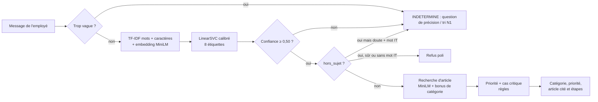

# Modèle de l'agent

## Chaîne de traitement

| Brique | Choix | Fichier |
| --- | --- | --- |
| Représentation | TF-IDF mots (1-2) + TF-IDF caractères (2-5) + `all-MiniLM-L6-v2` (384 dim.) | `support_agent/modele.py`, `encodeur.py` |
| Classifieur | `LinearSVC(C=1, class_weight="balanced")` calibré (sigmoïde, 3 plis) | `modele.py` |
| Exemples ajoutés | titre et symptômes des 57 articles (poids × 3) | `modele.py` (`exemples_base`) |
| Abstention | confiance < 0,50 (réglable : `SEUIL_ABSTENTION`) ou message sans mot porteur de sens | `modele.py` |
| Article | meilleure similarité MiniLM entre le message et le titre ou un symptôme, + 0,1 × probabilité de la catégorie de l'article | `kb.py` |
| Priorité | règles : catégorie critique, étendue (« nobody », « customers »…), urgence, demande simple | `priorite.py` |
| Cas critique | sécurité, panne de service, ou incident qui touche beaucoup de monde | `priorite.py` |

## Choix mesurés sur `jeu_validation.csv` (120 messages)

| Configuration | F1 macro |
| --- | --- |
| TF-IDF seul | 0,626 |
| TF-IDF + symptômes de la base | 0,844 |
| MiniLM seul + base | 0,804 |
| **TF-IDF + MiniLM + base** | **0,909** |

| Recherche d'article | Top-1 | Top-3 |
| --- | --- | --- |
| TF-IDF | 0,533 | 0,819 |
| MiniLM | 0,838 | 0,952 |
| **MiniLM + 0,1 × probabilité de catégorie** | **0,848** | **0,962** |

| Seuil d'abstention | Abstention | Exactitude des réponses données |
| --- | --- | --- |
| 0,40 | 4 % | 0,913 |
| **0,50** | **9 %** | **0,927** |
| 0,60 (valeur de la fiche) | 20 % | 0,927 |

Le seuil passe de 0,60 à 0,50 : à 0,60, l'agent s'abstient deux fois plus souvent, pour une exactitude identique.

Le jeu indépendant (`jeu_independant.csv`) n'a jamais servi à ces choix : il est réservé à la mesure finale (T12).

## Saisies inhabituelles (ajouté en T6)

| Étape | Règle |
| --- | --- |
| Correction des fautes | un mot **absent du dictionnaire** (mots entiers du tokenizer MiniLM, ~21 700) et du vocabulaire appris, de 4 lettres ou plus, est remplacé par le mot le plus proche parmi les 6 000 mots les plus fréquents du vocabulaire appris (difflib, ressemblance ≥ 0,8) : « printr brokn » → « printer broken ». Un mot correct (« ransom », « stole ») n'est jamais modifié ; si sa forme de base existe (« renewing »), la correction doit commencer par cette base. Le texte corrigé est renvoyé dans `texte_corrige`. |
| Charabia | aucun mot du vocabulaire appris et prédiction `hors_sujet` → `INDETERMINE`, raison `incomprehensible` : l'agent demande de reformuler. |
| Champ `raison` | pourquoi l'agent s'abstient : `vague`, `incomprehensible`, `confiance_faible`, `hors_sujet_douteux`. |
