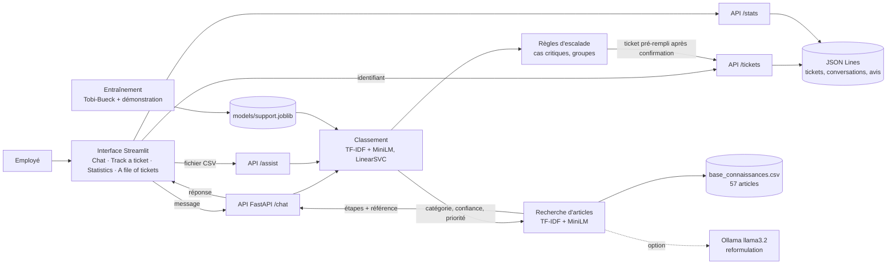

# Livrable 3 : maquette globale

Rédacteur : Aadoud Anass   Relecteur : Gouraguine Zakaria   Fichiers : `docs/semaine1/3-maquette.md` + `docs/semaine1/img/`

Retour à la répartition : [README](README.md)

**3.1 Schéma d'architecture.**

**3.2 Légende du schéma**
- Interface Streamlit : point d'entrée de l'employé et du technicien (F1, F2, F3).
- `/chat` : un tour de conversation, garde l'état (tentatives, article proposé) (F1, F2).
- `/assist` : décision sur un incident isolé, utilisée par l'onglet fichier (F3).
- `/tickets` : création après confirmation, lecture et suivi d'un ticket (F2).
- `/stats` : compte des tickets, résolutions et avis (F3).
- Classement : catégorie, confiance, priorité, abstention et hors sujet (F1, F3).
- Recherche d'articles et base de connaissances : les 3 articles les plus proches, avec leurs étapes (F1).
- Ollama (pointillés) : reformulation optionnelle de l'article, désactivée par défaut (F1).
- Règles d'escalade : cas critiques, deux échecs, demande de l'utilisateur, choix du groupe (F2, F3).
- Stockage JSON Lines : tickets, conversations, avis, hors de Git (F2, F3).
- Entraînement et modèle enregistré : produits hors ligne par `src/train.py` (F1).

**3.3 Maquette des écrans.** Maquettes fil de fer (SVG) des 4 onglets de l'interface Streamlit.

| Écran | Image (`img/...`) | Fonctionnalités affichées | Action principale de l'utilisateur |
| --- | --- | --- | --- |
| Chat | `img/1-chat.svg` | F1 (catégorie, priorité, étapes, article cité, autres articles), F2 (proposition de ticket, confirmation) | Décrire l'incident, répondre « résolu » ou « pas résolu », confirmer le ticket |
| Track a ticket | `img/2-suivi.svg` | F2 (statut, groupe, priorité, articles essayés) | Saisir l'identifiant du ticket |
| A file of tickets | `img/3-fichier.svg` | F3 (tableau trié, cas critiques en tête, article proposé par ligne) | Déposer un CSV d'incidents et télécharger le résultat |
| Statistics | `img/4-statistiques.svg` | F3 (tickets par catégorie, taux de résolution, avis) | Consulter les indicateurs |

### Les quatre écrans

**Chat**

**Track a ticket**

**A file of tickets**

**Statistics**

**3.4 Parcours utilisateur** : Chat → l'employé décrit l'incident → l'agent affiche catégorie, priorité et procédure → « pas résolu » → deuxième article ou question de précision → « pas résolu » → proposition de ticket pré-rempli → confirmation → identifiant affiché → onglet Track a ticket → saisie de l'identifiant → statut du ticket.

## Critères d'acceptation (vérifiés par le relecteur)

- [ ] Chaque composant du livrable 1 apparaît dans le schéma, et inversement.
- [ ] Le parcours d'une requête se suit de bout en bout sur le schéma.
- [ ] Chaque fonctionnalité du MVP est visible sur au moins un écran.
- [ ] Le schéma s'affiche correctement sur GitHub (Mermaid valide ou image présente).
- [ ] Pour une équipe de 4 : les agents ou sous-systèmes et leurs échanges sont représentés.
