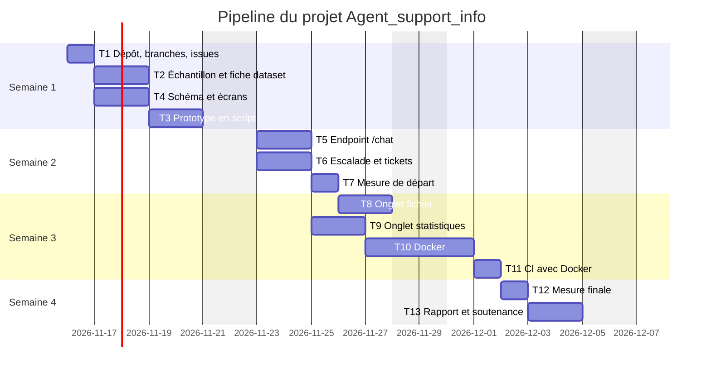

# Livrable 4 : pipeline des tâches prévues

Consolidateur : Gouraguine Zakaria   Relecteur : Aadoud Anass   Fichier : `docs/semaine1/4-pipeline.md`

Retour à la répartition : [README](README.md)

**4.1 Liste des tâches**

| ID | Tâche | Fonctionnalité | Responsable | Dépend de | Semaine | Terminée quand ? (critère vérifiable) |
| --- | --- | --- | --- | --- | --- | --- |
| T1 | Dossier `docs/semaine1/`, README de répartition, branches et issues GitHub | Toutes | Anass | — | 1 | Les 4 branches existent, une issue par tâche, `pytest -q` vert sur `main` |
| T2 | Échantillon `data/sample/` (100 tickets Tobi-Bueck, base, jeu d'or) et fiche dataset | F1 | Zakaria | T1 | 1 | Les 3 fichiers s'ouvrent avec `pandas.read_csv` sans erreur, moins de 10 Mo |
| T3 | Prototype en script : incident → catégorie → article | F1 | Anass | T2 | 1 | `python src/predict.py "My VPN keeps disconnecting"` affiche `reseau` et `KB-NET-01` |
| T4 | Schéma Mermaid et captures des 4 écrans | F1, F2, F3 | Anass | T1 | 1 | Le schéma s'affiche sur GitHub, 4 maquettes dans `docs/semaine1/img/` |
| T5 | Endpoint `/chat` : conversation, tentatives, question de précision | F1 | Anass | T3 | 2 | Les tests de `tests/test_chat.py` passent ; un incident résolu ne crée aucun ticket |
| T6 | Règles d'escalade et ticket pré-rempli (`/tickets`, cas critiques) | F2 | Zakaria | T3 | 2 | `tests/test_escalade.py` vert ; les 30 conversations donnent 10 tickets, tous attendus |
| T7 | Mesure de départ sur la validation (F1 macro, top-1, top-3) | F1 | Zakaria | T3 | 2 | `python src/evaluer.py validation` écrit un JSON avec les trois chiffres |
| T8 | Onglet fichier et `/assist` sur un CSV | F3 | Zakaria | T6 | 3 | Le dépôt de `jeu_independant.csv` affiche 126 lignes triées, cas critiques en tête |
| T9 | Onglet statistiques et `/stats`, `/feedback` | F3 | Anass | T5, T6 | 3 | `/stats` renvoie les compteurs par catégorie ; l'onglet les affiche après 3 tickets créés |
| T10 | Dockerfile et `docker compose` (API + interface) | Toutes | Anass | T5, T6 | 3 | `docker compose up` puis `curl /health` renvoie `ok` ; l'interface répond sur le port 8501 |
| T11 | CI : construction de l'image Docker et tests | Toutes | Zakaria | T10 | 3 | Le workflow GitHub Actions est vert sur `main`, couverture ≥ 95 % |
| T12 | Mesure finale sur le jeu indépendant (lu une seule fois) | F1, F2, F3 | Zakaria | T8, T11 | 4 | Tableau final : F1 macro, top-1, top-3, cas critiques manqués, hors sujet refusé |
| T13 | Rapport, README final et répétition de la soutenance | Toutes | Anass et Zakaria | T12 | 4 | Démonstration du scénario 1.3 en moins de 5 minutes, code gelé et étiqueté `v1.0` |

**4.2 Jalons hebdomadaires** (repris de la fiche de cadrage)

| Semaine | Jalon démontrable | Tâches qui y mènent |
| --- | --- | --- |
| 1 | Dossier de lancement fusionné, prototype en script | T1, T2, T3, T4 |
| 2 | Agent exposé par l'API, premiers tests | T5, T6, T7 |
| 3 | MVP complet, Docker et CI au vert | T8, T9, T10, T11 |
| 4 | Résultats mesurés, code gelé, soutenance | T12, T13 |

**4.3 Vue chronologique.**

**4.4 Chemin critique et charge**

- Chaîne de tâches dont le moindre retard décale la soutenance : T1 → T2 → T3 → T6 → T8 → T10 → T11 → T12 → T13 (Docker et la CI conditionnent la mesure finale).
- Charge par membre (nombre de jours de tâches) : Aadoud Anass : T1 (1) + T3 (2) + T4 (2) + T5 (2) + T9 (2) + T10 (2) + moitié de T13 (1) = 12 jours ; Gouraguine Zakaria : T2 (2) + T6 (2) + T7 (1) + T8 (2) + T11 (1) + T12 (1) + moitié de T13 (1) + consolidation du livrable 4 et relectures (2) = 12 jours. Écart : 0 jour (T13 est partagé : Anass la démonstration, Zakaria le rapport des mesures).

## Critères d'acceptation (vérifiés par le relecteur)

- [ ] Aucune tâche ne dépasse 2 jours.
- [ ] Chaque fonctionnalité du MVP a au moins une tâche, et chaque tâche a un critère de fin vérifiable.
- [ ] Le MVP est complet au plus tard en fin de semaine 3.
- [ ] Chaque membre a saisi ses propres tâches ; l'écart de charge entre membres reste inférieur à 2 jours.
- [ ] Les tâches existent comme issues GitHub.
